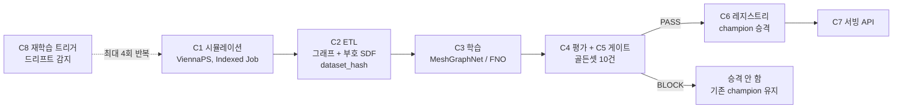

<div align="center">


<h2>etch-pipeline (식각 공정 AI 대리 모델의 검증·재학습 자동화 파이프라인)</h2>
<p>ViennaPS 시뮬레이션 데이터로 대리 모델을 학습하고, 회귀 게이트를 통과한 모델만 등록·서빙하는 MLOps 워크플로우</p>

<p><a href="#quick-start">Quick Start</a> | <a href="#install">Install</a> | <a href="#pipeline">Pipeline</a> | <a href="#how-to-use">Usage</a> | <a href="#data-format">Data</a> | <a href="#option-table">Options</a> | <a href="#trouble-shooting">Troubleshooting</a></p>

</div>

---

## Overview

식각 공정 대리 모델(surrogate model)은 느리고 정확한 시뮬레이터의 결과를 배워 빠르게 맞히는 모델입니다. 이 저장소가 만들려는 것은 모델 자체가 아니라, 모델의 수명주기(데이터 생성, 학습, 평가, 검증, 배포, 재학습)를 자동으로 돌리는 파이프라인입니다.

| 단계 | 하는 일 |
|---|---|
| 데이터 생성 | 2D 트렌치 식각(SF6/O2, Si + 마스크) 레시피를 Sobol 샘플링하고 ViennaPS로 시뮬레이션 |
| 변환 | 시뮬레이션 표면을 그래프와 부호 있는 거리장(SDF)으로 바꾸고 내용 해시(`dataset_hash`)로 데이터 버전을 식별 |
| 회귀 게이트 | 고정된 골든셋 10건으로 모델을 평가해 PASS 또는 BLOCK을 판정. 데이터 무결성 위반은 종료 코드 2 |
| 레지스트리 | 게이트를 통과한 모델만 `champion`으로 승격하고 모든 시도를 `history.jsonl`에 기록 |
| 서빙 | `ETCH_API_KEY`로 보호되는 FastAPI (`/health`, `/model`, `/predict`) |

정답 데이터는 ViennaPS 시뮬레이션이며, 팹에서 수집한 데이터는 사용하지 않습니다. 대리 모델은 정밀 시뮬레이션의 보완 수단이고 학습한 파라미터 범위 안에서만 유효합니다.

> [!IMPORTANT]
> 진행 중인 프로젝트이며, 설치해서 한 번에 돌려 보는 전체 데모는 아직 없습니다. 아래 표는 이 저장소의 코드 기준 구현 상태입니다. 주차별 진행 상황은 [`docs/project-checklist.md`](docs/project-checklist.md)의 체크박스와 [`reports/evidence/`](reports/evidence)가 기준이며, 이 README에는 주차를 적지 않습니다.

| 컴포넌트 | 위치 | 코드 기준 상태 |
|---|---|---|
| C1 시뮬레이션 러너 | `src/etchpipe/sim/`, `deploy/k8s/`, `docker/` | 구현. 레시피 샘플링, 단건 실행, 샤드 배치, Kubernetes Indexed Job |
| C2 ETL | `src/etchpipe/etl/` | 구현. 그래프, 부호 SDF, 정규화 통계, `dataset_hash`, 데이터 검증 |
| C3 학습 | `src/etchpipe/models/` | 일부. 더미 모델 2종과 깊이 MLP 베이스라인만 있음. MeshGraphNet, FNO 학습 코드는 아직 없음 |
| C4 평가 | `src/etchpipe/eval/` | 일부. Chamfer 거리와 깊이 오차만 구현 |
| C5 회귀 게이트 | `src/etchpipe/gate/` | 최소판. 골든 Chamfer, 롤아웃 후반 오차 급증, 해시 불일치 검사 |
| C6 레지스트리 | `src/etchpipe/registry/` | 최소판. 승격, `champion` 포인터, `history.jsonl` |
| C7 서빙 | `src/etchpipe/serve/` | 골격. 엔드포인트와 인증은 동작하지만 모델은 연결되지 않았고 `/predict`는 빈 프로파일을 반환 |
| C8 재학습 트리거 | 없음 | 미착수. 설계만 있음 ([ADR-0002](docs/adr/0002-auto-retry-retrain-loop.md)) |
| C9 대시보드 | `src/etchpipe/dashboard/` | 미착수. 빈 패키지 |

---

## Quick Start

> 저장소 루트에서, 가상환경(venv)을 활성화한 상태로 실행합니다. 시뮬레이터(ViennaPS)와 PyTorch 없이 돌아가는 부분입니다.

```bash
# 1) 개발 환경 설치
python -m venv .venv
# Win: .venv\Scripts\activate   /   macOS/Linux: source .venv/bin/activate
pip install -U pip
pip install -r requirements-dev.txt
pip install -e .
pip install shapely==2.2.0

# 2) 파이프라인 스모크: 픽스처 -> ETL -> 더미 모델 -> 평가 -> 게이트 -> 레지스트리 -> 서빙 호출
python scripts/run_pipeline_smoke.py

# 3) 게이트 부정 테스트: 정상 모델 통과, 망가진 모델 차단, 해시 변조 차단
python scripts/run_gate_negative.py
```

게이트 부정 테스트는 세 케이스가 기대한 종료 코드와 일치하면 `0`으로 끝납니다.

```text
[OK] 정상 모델(변위 0): 기대=0 실제=0 reasons=[]
[OK] 무작위 변위 모델(망가진 모델): 기대=1 실제=1 reasons=['golden chamfer 4.1405 > max 0.1000']
[OK] dataset_hash 불일치: 기대=2 실제=2 reasons=['dataset_hash mismatch: expected dataset-v1, got tampered']

gate-negative 통과: 3개 케이스 모두 기대대로 동작
```

스모크 스크립트는 `build/pipeline_smoke/`에 `processed/`, `registry/`, `summary.json`을 남깁니다. `build/`는 Git에서 제외됩니다.

> [!NOTE]
> `shapely`는 `pyproject.toml`과 `requirements-dev.txt`에 없지만 `etchpipe.etl.etl`이 import 시점에 필요로 합니다(`requirements-train.txt`에 고정된 버전을 그대로 썼습니다). 빼면 스모크와 `tests/unit/test_etl.py`가 `ModuleNotFoundError: shapely`로 멈춥니다.

---

## Install

환경은 목적별로 네 개로 나뉘며, 서로 의존성이 충돌하지 않도록 단계 사이는 파일로만 연결합니다.

| 환경 | 파일 | 용도 | 실행 위치 |
|---|---|---|---|
| dev | `requirements-dev.txt` + `pip install -e .` | 린트, 테스트, 스모크, 서빙 골격 실행 | 호스트 가능 |
| sim | `requirements-sim.txt`, `docker/Dockerfile.sim` | ViennaPS 시뮬레이션 (Python 3.13) | 컨테이너 전용 |
| train | `requirements-train.txt` | ETL, 학습, 평가 (Python 3.11, CPU) | 컨테이너 전용 |
| serve | `requirements-serve.txt` | 서빙 (torch CPU + FastAPI) | 컨테이너 전용 |

> Linux에서 `import viennaps`나 VTK 계열 import가 `libX11.so.6` 같은 오류로 실패하면 아래 패키지가 필요합니다(CI와 `Dockerfile.sim`이 같은 목록을 설치합니다).
> `apt-get install -y --no-install-recommends libgl1 libxrender1 libxext6 libsm6 libice6 libx11-6`

<details>
<summary><strong>train 환경 설치 순서 (한 번에 설치하지 않음)</strong></summary>

`requirements-train.txt`의 고정 버전은 아래 순서로 설치했을 때 컨테이너에서 확인된 조합입니다. 전체를 `-r`로 한 번에 설치하는 방식은 검증하지 않았습니다.

```bash
# 1) torch는 반드시 CPU 휠 인덱스에서 (PyPI torch는 CUDA 라이브러리 약 10GB를 함께 받음)
pip install --index-url https://download.pytorch.org/whl/cpu torch==2.14.1 torchvision==0.29.1
# 2) PhysicsNeMo, PyG
pip install nvidia-physicsnemo==2.2.2 torch_geometric==2.8.1
# 3) torch_scatter는 torch 설치 후 소스 빌드 (build-essential, gcc, g++ 필요)
pip install --no-build-isolation torch_scatter==2.1.2
# 4) ETL용
pip install pyvista==0.49.1 numpy==2.4.6 scipy==1.17.1
# 5) SDF 내부 경계 필터용
pip install shapely==2.2.0
```

</details>

<details>
<summary><strong>핵심 패키지 버전</strong></summary>

```text
[sim]    ViennaPS==4.5.0   ViennaLS==5.8.5   numpy==2.5.4   scipy==1.18.1
[train]  torch==2.14.1   torchvision==0.29.1   nvidia-physicsnemo==2.2.2   torch_geometric==2.8.1
         torch_scatter==2.1.2   pyvista==0.49.1   numpy==2.4.6   scipy==1.17.1   shapely==2.2.0
[serve]  torch==2.14.1   fastapi==0.162.0   uvicorn==0.54.0   pydantic==2.14.1   numpy==2.4.6
[dev]    ruff==0.17.3   pytest==9.1.1   detect-secrets==1.5.0   httpx==0.28.1
         fastapi==0.162.0   uvicorn==0.54.0   pydantic==2.14.1
```

ViennaLS는 5.8.5만 사용합니다. 기본 설치로 받아지는 5.9.0은 `import viennaps`가 실패합니다.

</details>

---

## Pipeline



이 그림은 설계상 흐름입니다. 구현 상태는 [Overview의 표](#overview)를 따르며, C8과 C3의 신경망 학습은 아직 코드가 없습니다. 단계 사이는 함수 호출이 아니라 파일(`data/raw`, `data/processed`, `runs/`, `registry/`)로만 연결합니다.

---

## Project architecture

```text
.
├─ src/etchpipe/
│  ├─ sim/
│  │  ├─ sampling.py          # Sobol 레시피 샘플링, OOD 샘플링, 분할, 골든 선정
│  │  ├─ run_sim.py           # run_sim(params, out_dir): ViennaPS 1건 실행, depth_max 정지조건
│  │  └─ sim_batch.py         # 샤드 단위 배치 실행기 (이어하기, 1회 재시도)
│  ├─ etl/etl.py              # .vtp -> 그래프/부호 SDF, dataset_hash, stats.json, 데이터 검증
│  ├─ models/
│  │  ├─ dummy.py             # 변위 0 모델, 무작위 변위 모델
│  │  └─ baseline.py          # 레시피 -> 깊이 MLP + 직선 외삽 (torch 필요)
│  ├─ eval/metrics.py         # chamfer_distance, depth, depth_error
│  ├─ gate/gate.py            # run_gate: PASS/BLOCK, 종료 코드 0/1/2
│  ├─ registry/registry.py    # Registry: promote, current_champion, history
│  ├─ serve/app.py            # FastAPI: /health, /model, /predict
│  └─ dashboard/              # 빈 패키지
├─ scripts/                   # 실행 진입점 (Option table 참고)
├─ configs/
│  ├─ sim/base.yaml           # 시뮬레이션 설정 (K, depth_max, 파라미터 범위, 분할 크기)
│  └─ etl/materials.yaml      # MaterialIds 매핑 (0=mask, 10=Si)
├─ golden/                    # 골든 레시피 10건 + 고정 정답 (golden.json, raw/)
├─ docker/Dockerfile.sim      # 시뮬레이션 이미지 (ViennaPS 4.5.0 + ViennaLS 5.8.5)
├─ deploy/k8s/                # kind 설정, PVC, 시뮬레이션 Job 매니페스트
├─ tests/
│  ├─ unit/                   # pytest 단위 테스트
│  └─ fixtures/raw/           # CI용 소형 시뮬레이션 결과 (r0000~r0002)
├─ docs/                      # 정의서, 설계서, 체크리스트, 데이터 카드, ADR
├─ reports/evidence/          # 항목별 실행 증거 (md, json, log)
├─ .github/workflows/pr-check.yml
├─ requirements-{dev,sim,train,serve}.txt
└─ pyproject.toml  LICENSE  NOTICE  CLAUDE.md  README.md
```

`data/`, `runs/`, `registry/`는 실행 중에 생기는 디렉터리이며 Git에서 제외됩니다.

---

## How to use

### 1) 레시피와 분할 만들기
- `configs/sim/base.yaml`의 시드(20261027)와 분할 크기를 코드에 맞춰 둔 스크립트입니다.
- 레시피 400건을 만들고 train 300, val 40, test 40, OOD 20으로 나눕니다. 분할은 레시피 단위입니다.

```bash
mkdir -p data
python scripts/gen_splits.py
# -> data/recipes.json, data/splits.json
```

### 2) 시뮬레이션 실행 (sim 환경)
- 레시피 1건은 `run_sim(params, out_dir)`이 처리합니다. 스냅샷은 한 스텝(1분)마다 `.vtp`로 저장되고, 식각 깊이가 `depth_max`(50 µm)에 닿으면 조기 종료합니다.
- 배치는 레시피를 `SIM_SHARDS`개 샤드로 나눠 한 프로세스가 샤드 하나를 맡습니다. `meta.json`이 이미 있는 레시피는 건너뛰므로 중단 후 이어서 실행할 수 있습니다.

```bash
# 단건: <recipes.json> <레시피 인덱스> [K]
python src/etchpipe/sim/run_sim.py data/recipes.json 0 20

# 샤드 배치: 샤드 번호는 JOB_COMPLETION_INDEX 환경변수 또는 첫 번째 인자
SIM_SHARDS=40 SIM_K=20 python src/etchpipe/sim/sim_batch.py 0
```

Kubernetes Indexed Job으로 돌릴 때는 아래 매니페스트를 씁니다.

| 파일 | 용도 |
|---|---|
| `deploy/k8s/kind-config.yaml` | 로컬 단일 노드 kind 클러스터 (`etch-pipeline`) |
| `deploy/k8s/pvc.yaml` | 결과를 모으는 공유 볼륨 `etch-data` (5Gi, ReadWriteOnce) |
| `deploy/k8s/sim-job-gen.yaml` | 본 데이터 생성. 샤드 40개, 동시 2개, 파드당 cpu 6 |
| `deploy/k8s/sim-job-local.yaml` | 로컬 시험. 샤드 4개, K=2 |
| `deploy/k8s/sim-job-probe.yaml` | 소규모 측정용 |
| `deploy/k8s/sim-job.yaml` | 더 쓰지 않음. cpu 2로는 처리 속도가 나오지 않으므로 적용하지 않음 |

```bash
# 1) 이미지 빌드 (빌드 전에 data/recipes.json이 있어야 함)
docker build -f docker/Dockerfile.sim -t etch-sim:0.1 .
# 2) 클러스터와 볼륨
kind create cluster --config deploy/k8s/kind-config.yaml
kind load docker-image etch-sim:0.1 --name etch-pipeline
kubectl apply -f deploy/k8s/pvc.yaml
# 3) 본 데이터 생성
kubectl apply -f deploy/k8s/sim-job-gen.yaml
# 4) 진행률 확인 (--retry: Job이 Failed면 삭제 후 재적용, 완료분은 자동으로 건너뜀)
python scripts/sim_progress.py
```

> `sim-job-gen.yaml`은 `SIM_RECIPES=/data/recipes.json`을 읽으므로 레시피 파일이 PVC의 `/data`에 있어야 합니다. 이 복사 단계를 자동화한 스크립트는 저장소에 없습니다(증거 문서에는 PVC를 마운트한 임시 파드와 `kubectl cp`를 쓴 기록이 있습니다). 클러스터를 쓸 수 없으면 같은 `sim_batch.py`를 샤드 번호만 바꿔 여러 프로세스로 실행하면 됩니다.

### 3) 데이터 검증
- 모든 run의 스냅샷 개수(K+1, 조기 종료 시 `actual_k`+1), NaN/Inf 없음, 점 수 0 초과, 깊이 비감소를 확인하고 점 수 최대치(그래프 크기 예산)를 보고합니다.
- 오류가 있는 run이 하나라도 있으면 종료 코드 `1`입니다.

```bash
python scripts/validate_data.py tests/fixtures/raw
# 3 runs checked, 0 with errors
# max_n_points (그래프 크기 예산) = 323
```

### 4) ETL
- 스냅샷마다 그래프(`g###.npz`)와 부호 있는 거리장(`sdf###.npy`)을 만들고, 정규화 통계(`stats.json`)는 train split에서만 계산합니다.
- 출력 디렉터리 이름이 `dataset_hash`이므로 레시피 집합이 바뀌면 경로가 달라집니다. CLI는 없고 함수로 호출합니다.

```python
import json
from etchpipe.etl.etl import THETA_KEYS, process_dataset

splits = json.load(open("data/splits.json"))
manifest = process_dataset("data/raw", splits, "data/processed", THETA_KEYS, max_workers=4)
print(manifest["dataset_hash"])
# -> data/processed/<dataset_hash>/{graphs/<run_id>/, splits.json, stats.json, manifest.json}
```

### 5) 평가, 게이트, 레지스트리
- `run_gate`는 모델과 골든 쌍 `(입력 표면, 정답 표면)` 목록을 받아 판정합니다. 모델은 `predict(pos) -> pos` 메서드만 있으면 됩니다.
- 판정이 PASS일 때만 `champion`이 바뀌고, BLOCK도 `history.jsonl`에 남습니다.

```python
from etchpipe.gate.gate import run_gate
from etchpipe.models.dummy import ZeroDisplacementModel
from etchpipe.registry.registry import Registry

result = run_gate(ZeroDisplacementModel(), golden_pairs, max_chamfer=0.1)
registry = Registry("registry")
registry.promote("model-0001", result)   # result.passed 가 True일 때만 champion 갱신
print(registry.current_champion(), registry.history())
```

| 종료 코드 | 의미 |
|---|---|
| `0` | PASS |
| `1` | BLOCK: 골든 평균 Chamfer 초과, 또는 롤아웃 후반 오차 급증 |
| `2` | BLOCK: 데이터 무결성. `dataset_hash` 또는 골든 해시 불일치 |

### 6) 서빙 골격
- `ETCH_API_KEY` 환경변수가 없으면 서버가 기동 자체를 거부합니다.
- 현재는 모델을 로드하지 않습니다. `/model`은 `dummy-champion`을, `/predict`는 입력 형식만 검증한 빈 프로파일을 반환합니다.

```bash
ETCH_API_KEY=<임의의 키> uvicorn etchpipe.serve.app:app --port 8000
```

| 메서드 | 경로 | 인증 | 설명 |
|---|---|---|---|
| `GET` | `/health` | 불필요 | `{"status": "ok"}` |
| `GET` | `/model` | `x-api-key` | 현재 모델 정보 (현재는 더미 고정값) |
| `POST` | `/predict` | `x-api-key` | 레시피 배치와 시각 목록을 받아 프로파일 반환 (현재는 빈 `points`) |

```bash
curl -s -X POST localhost:8000/predict \
  -H "x-api-key: <임의의 키>" -H "content-type: application/json" \
  -d '{"recipes":[{"ion_flux":10,"etchant_flux":5000,"oxygen_flux":800,
       "ion_mean_energy":100,"ion_exponent":300,"mask_width":10,"mask_height":10}],
       "times":[0.5]}'
# {"model_version":"dummy-champion","results":[{"profiles":[{"t":0.5,"points":[]}],
#   "cd":0.0,"depth":0.0,"taper_deg":0.0,"in_range":true}]}
```

### 7) 테스트와 린트

```bash
python -m pytest tests/unit -v
ruff check .
python scripts/check_forbidden_expressions.py
```

`tests/unit/test_baseline.py`는 `torch`가 있어야 수집됩니다. dev 환경만 설치한 상태에서는 `--ignore=tests/unit/test_baseline.py`를 붙여 나머지를 실행하세요.

---

## Data format

시뮬레이션 1건(run)은 아래 구조로 저장되며, 한 번 쓴 raw 데이터는 수정하지 않습니다.

```text
data/raw/<run_id>/
├─ meta.json
└─ snapshots/t000.vtp ... t0KK.vtp     # 시간 스텝별 2D 표면 선분 메시 (MaterialIds, Normals 셀 데이터)
```

`meta.json` 예시 (`golden/raw/r0007/meta.json`):

```json
{
  "params": {
    "ion_flux": 9.889652374465498,
    "etchant_flux": 3090.2480668684298,
    "oxygen_flux": 1245.8361892673583,
    "ion_mean_energy": 92.96157043427229,
    "ion_exponent": 318.31318049957326,
    "mask_width": 10.428883522748947,
    "mask_height": 9.890424057841301
  },
  "K": 20,
  "actual_k": 20,
  "step_min": 1.0,
  "rays": 300,
  "seed": 42,
  "grid_delta": 0.3,
  "depth_max": 50.0,
  "stopped_early": false,
  "final_depth_um": 33.3,
  "viennaps": "4.5.0",
  "wall_sec": 810.3,
  "params_hash": "8c3c27d1a6"
}
```

- `params_hash`는 `sha1(json.dumps(params, sort_keys=True))[:10]`입니다.
- `dataset_hash`는 `run_id` 순서로 `params_hash`를 이어 붙인 문자열의 sha1 앞 12자리입니다. 레시피가 하나라도 바뀌면 달라집니다.
- 점 개수는 스냅샷마다 다르고, 조기 종료한 run은 `actual_k < K`입니다.

입력 파라미터 Θ는 7개이며 범위가 곧 모델의 유효 범위입니다. OOD 평가용 레시피는 이 범위를 최대 1.5배까지 벗어난 구간에서 따로 샘플링합니다.

| 이름 | ViennaPS 파라미터 | 범위 | 스케일 |
|---|---|---|---|
| `ion_flux` | `ionFlux` | 3 ~ 30 | log |
| `etchant_flux` | `etchantFlux` | 1350 ~ 13500 | log |
| `oxygen_flux` | `passivationFlux` | 240 ~ 2400 | log |
| `ion_mean_energy` | `Ions.meanEnergy` | 50 ~ 200 | linear |
| `ion_exponent` | `Ions.exponent` | 100 ~ 1000 | log |
| `mask_width` | `MakeTrench(trenchWidth)` | 6 ~ 14 µm | linear |
| `mask_height` | `MakeTrench(maskHeight)` | 6 ~ 14 µm | linear |

| 분할 | 레시피 수 | 용도 |
|---|---|---|
| train | 300 | 학습. 정규화 통계도 여기서만 계산 |
| val | 40 | 검증 |
| test | 40 | 최종 평가 |
| OOD | 20 | 학습 범위 밖 평가 |
| golden | 10 (train의 부분집합) | 회귀 게이트 기준점. 고정, 재생성 금지 |

> [!WARNING]
> 골든셋(`golden/`)은 한 번 만든 뒤 바꾸지 않는 기준점입니다. `tests/unit/test_golden.py`가 `golden_hash`로 변경을 감지하므로 `scripts/make_golden.py`를 다시 실행하지 마세요. 또한 데이터 카드에 따르면 외부에 올려 둔 데이터 백업(GitHub Release `data-v1-n400`, Hugging Face Datasets `code5312/etch-ai-automation-data`)은 OOD 버그 수정 이전 버전이라 일부 OOD 레시피가 다릅니다. 생성 방법, 실측 통계, 알려진 한계는 [`docs/data_card.md`](docs/data_card.md)를 확인하세요.

---

## Option table

| 스크립트 | 인자 / 옵션 | 설명 |
|---|---|---|
| `scripts/gen_splits.py` | (없음) | `data/recipes.json`(400건)과 `data/splits.json` 생성. `data/` 디렉터리가 먼저 있어야 함 |
| `src/etchpipe/sim/sampling.py` | `[n]` | 레시피 `n`건(기본 400)을 `data/recipes.json`으로 저장 |
| `src/etchpipe/sim/run_sim.py` | `<recipes.json> <인덱스> [K]` | 레시피 1건 실행, `data/raw/<run_id>/`에 저장. `K` 기본 20 |
| `src/etchpipe/sim/sim_batch.py` | `[샤드 번호]` + 환경변수 | 샤드 배치 실행. 환경변수는 아래 표 |
| `scripts/sim_progress.py` | `--retry` | kind의 `etch-sim-gen` Job 진행률 출력. `--retry`는 Job이 Failed일 때 재적용 |
| `scripts/validate_data.py` | `[raw_dir] [splits.json]` | raw 데이터 검증. 기본 `data/raw`. `splits.json`이 있으면 그 run만 검사. 오류 시 종료 코드 1 |
| `scripts/make_golden.py` | `[recipes] [splits] [raw_dir] [out_dir]` | 골든셋 선정·복사. 이미 확정되어 있으므로 실행하지 않음 |
| `scripts/run_baselines.py` | `[data_dir]` | val 40건으로 베이스라인 2종 평가 후 `reports/evidence/W3-07_baseline_metrics.json`을 덮어씀. torch 필요 |
| `scripts/run_pipeline_smoke.py` | (없음) | 픽스처로 ETL부터 서빙 호출까지 한 번 통과. 실패 시 종료 코드 1 |
| `scripts/run_gate_negative.py` | (없음) | 게이트 부정 테스트 3종. `build/gate_negative_report.json` 저장 |
| `scripts/check_forbidden_expressions.py` | (없음) | `src`, `scripts`, `tests`, `README.md`에서 금지 표현을 검사. 발견 시 종료 코드 1 |
| `scripts/regen_ood_w3_12.py` | (없음) | OOD 12건 재생성용 1회성 스크립트. `etch-sim:0.1` 컨테이너 안에서만 실행 |

`scripts/mgn_smoke_test.py`는 초기 스파이크에서 가져온 원본이라 정식 진입점이 아닙니다.

환경변수:

| 변수 | 사용처 | 기본값 | 설명 |
|---|---|---|---|
| `ETCH_API_KEY` | 서빙 | 없음 (필수) | `x-api-key` 헤더와 비교할 키. 없으면 기동 거부 |
| `JOB_COMPLETION_INDEX` | `sim_batch.py` | 첫 번째 인자, 없으면 0 | 샤드 번호. Kubernetes Indexed Job이 자동 주입 |
| `SIM_SHARDS` | `sim_batch.py` | `1` | 전체 샤드 수. 레시피 `i`는 `i % SIM_SHARDS == 샤드 번호`일 때 처리 |
| `SIM_K` | `sim_batch.py` | `20` | 레시피당 스텝 상한 |
| `SIM_RECIPES` | `sim_batch.py` | `data/recipes.json` | 레시피 파일 경로 |
| `SIM_RAW` | `sim_batch.py` | `data/raw` | 결과 저장 디렉터리 |

---

## Testing and CI

`.github/workflows/pr-check.yml`은 PR과 `main` push마다 아래 여섯 잡을 실행합니다.

| 잡 | Python | 내용 |
|---|---|---|
| `lint` | 3.11 | `ruff check .` |
| `unit-tests` | 3.11 | `pytest tests/unit -v` |
| `viennaps-smoke` | 3.13 | `requirements-sim.txt` 설치 후 `import viennaps` |
| `pipeline-smoke` | 3.11 | `python scripts/run_pipeline_smoke.py` |
| `gate-negative` | 3.11 | `python scripts/run_gate_negative.py` |
| `forbidden-expressions` | 3.11 | `python scripts/check_forbidden_expressions.py` |

`pre-commit`은 `detect-secrets`(`.secrets.baseline` 기준)와 `detect-private-key`를 실행합니다.

---

## Secure

- **API 키**: 키는 환경변수 `ETCH_API_KEY`로만 받습니다. 없으면 서버가 기동하지 않고, 비교는 `hmac.compare_digest`(상수 시간)로 합니다. `/health`만 키 없이 열려 있습니다.
- **비밀값**: `data/`, `.env`, 키는 커밋하지 않으며 `detect-secrets`와 `detect-private-key`가 pre-commit에서 검사합니다.
- **재현성**: Sobol 샘플링 시드(20261027), 레이 트레이싱 시드(`rngSeed=42`, `useRandomSeeds=False`)를 고정하고 `meta.json`에 기록합니다. 같은 입력이면 같은 `dataset_hash`가 나옵니다.
- **데이터 무결성**: 게이트는 `dataset_hash`와 골든 해시가 기대값과 다르면 성능을 보기 전에 종료 코드 2로 차단합니다. 레지스트리는 PASS가 아니면 `champion`을 바꾸지 않습니다.
- **데이터 누수 방지**: 분할은 레시피 단위이고 정규화 통계는 train에서만 계산합니다. OOD는 학습 범위 밖에서 따로 샘플링합니다.
- **의존성 고정**: 모든 requirements 파일이 `==`로 고정되어 있고 `tests/unit/test_requirements_pinning.py`가 이를 검사합니다.
- **표현 규칙**: 코드와 README에 쓰면 안 되는 표현 목록을 `scripts/check_forbidden_expressions.py`가 CI에서 검사합니다.

---

## Trouble shooting

<details>
<summary><strong>ModuleNotFoundError: No module named 'shapely'</strong></summary>

`shapely==2.2.0`을 설치하세요. `etchpipe.etl.etl`이 import 시점에 필요로 하지만 `pyproject.toml`과 `requirements-dev.txt`에는 들어 있지 않습니다. `requirements-dev.txt`와 `pip install -e .`만 설치한 환경에서 `run_pipeline_smoke.py`와 `tests/unit/test_etl.py`가 이 오류로 멈추는 것을 확인했습니다.

</details>

<details>
<summary><strong>tests/unit/test_baseline.py 수집 단계에서 No module named 'torch'</strong></summary>

베이스라인 모델이 `torch`를 import합니다. train 환경을 쓰거나, CPU 휠 인덱스(`pip install --index-url https://download.pytorch.org/whl/cpu torch==2.14.1`)로 설치하세요. 인덱스를 지정하지 않으면 CUDA 라이브러리까지 약 10GB를 받습니다. 이 테스트만 건너뛰려면 `--ignore=tests/unit/test_baseline.py`를 쓰세요.

</details>

<details>
<summary><strong>RuntimeError: ETCH_API_KEY 환경변수가 없어 서빙을 시작할 수 없습니다</strong></summary>

설계된 동작입니다. 서빙 모듈은 import 시점에 키를 검사합니다. `ETCH_API_KEY=<값>`을 지정해 실행하세요. 테스트는 `tests/conftest.py`가 테스트 전용 값을 넣어 줍니다.

</details>

<details>
<summary><strong>import viennaps에서 libX11.so.6 ImportError, 또는 ViennaLS import 실패</strong></summary>

앞의 오류는 [Install](#install)의 `apt-get` 패키지 목록으로 해결됩니다. 뒤의 오류는 ViennaLS 5.9.0이 설치된 경우이며 `ViennaLS==5.8.5`로 고정해야 합니다(`requirements-sim.txt` 그대로 설치).

</details>

<details>
<summary><strong>시뮬레이션 Job이 오래 걸리고 레시피가 끝나지 않음</strong></summary>

ViennaPS 레이 트레이싱은 내부적으로 스레드를 10개 넘게 씁니다. 파드의 cpu 한도가 1이면 30분 동안 레시피 1건도 끝내지 못한 기록이 있습니다. `sim-job-gen.yaml`처럼 파드당 cpu 6, 동시 2개로 맞추고, 호스트 코어 수 안에서 조정하세요. `deploy/k8s/sim-job.yaml`(cpu 2)은 더 쓰지 않는 파일입니다.

</details>

<details>
<summary><strong>sim_progress.py가 파드를 찾지 못함</strong></summary>

이 스크립트는 kubectl 컨텍스트 `kind-etch-pipeline`의 `etch-sim-gen` Job 파드에 `exec`로 들어가 `/data`를 조회합니다. Job이 끝나 파드가 하나도 남지 않은 상태는 처리하지 못합니다. 이때는 임시 파드에 `etch-data` PVC를 마운트해서 직접 확인하세요.

</details>

<details>
<summary><strong>torch_scatter 소스 빌드 실패</strong></summary>

torch를 먼저 설치한 뒤 `pip install --no-build-isolation torch_scatter==2.1.2`로 설치해야 하며, `build-essential`(gcc, g++)이 필요합니다.

</details>

<details>
<summary><strong>validate_data.py에서 스파이크 흔적 때문에 오류가 나옴</strong></summary>

`data/raw`에 초기 스파이크 결과(예: `r0000_s1k2`)가 섞여 있으면 옛 스키마라 오류로 잡힙니다. `data/splits.json`을 같이 두면 그 파일에 있는 run만 검사합니다.

</details>

---

## Scope

| 구분 | 내용 |
|---|---|
| 범위 | 단일 시나리오(2D 트렌치 식각, SF6/O2). 가상 시뮬레이션 데이터만 사용 |
| 하지 않는 것 | 장비 제어, 3D, KMC/MD 멀티스케일, 팹 수집 데이터 사용, 모델 성능 극대화 |
| 미측정 | 추론 속도 이득. 측정하지 않은 수치는 문서에 적지 않음 |
| 제외 기술 | PhysicsNeMo Curator, ONNX/Triton, Slurm, MLflow, DVC, Transolver |

---

## Docs

| 문서 | 내용 |
|---|---|
| [`docs/project-definition.md`](docs/project-definition.md) | 무엇을, 왜 만드는가 (정본, 우선순위 1) |
| [`docs/project-design.md`](docs/project-design.md) | 컴포넌트 C1~C9, API, CI 설계 (우선순위 2) |
| [`docs/project-checklist.md`](docs/project-checklist.md) | 항목별 작업과 실행 증거 (우선순위 3) |
| [`docs/data_card.md`](docs/data_card.md) | 데이터 생성 방법, 범위, 알려진 한계 |
| [`docs/adr/`](docs/adr) | 인터페이스 동결(0001), 자동 반복 재학습(0002), 부호 SDF 규약(0003) |
| [`reports/evidence/`](reports/evidence) | 항목별 실행 증거 |
| [`CLAUDE.md`](CLAUDE.md) | 이 저장소에서 작업할 때의 범위, 원칙, 규칙 |

## License

저장소 코드는 [Apache-2.0](LICENSE)입니다. ViennaPS(GPL-3.0)를 포함하는 시뮬레이션 이미지(`docker/Dockerfile.sim`)에는 별도 조건이 적용되며, 자세한 내용은 [`NOTICE`](NOTICE)를 참고하세요.

---

<div align="center">
개선 제안과 이슈를 환영합니다.
</div>
