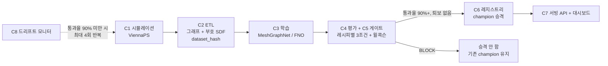

<div align="center">


<h2>etch-pipeline (식각 공정 AI 대리 모델의 검증·재학습 자동화 파이프라인)</h2>
<p>ViennaPS 시뮬레이션 데이터로 대리 모델(MeshGraphNet/FNO)을 학습하고, 레시피별 회귀 게이트를 통과한 모델만 등록·서빙·재학습하는 MLOps 워크플로우</p>

<p><a href="#quick-start">Quick Start</a> | <a href="#demo-한-줄-실행">Demo</a> | <a href="#증거-12-재현">Evidence ①②</a> | <a href="#install">Install</a> | <a href="#pipeline">Pipeline</a> | <a href="#how-to-use">Usage</a> | <a href="#api-endpoints">API</a> | <a href="#data-format">Data</a> | <a href="#option-table">Options</a> | <a href="#trouble-shooting">Troubleshooting</a></p>

</div>

---

## Overview

식각 공정 대리 모델(surrogate model)은 느리고 정확한 시뮬레이터의 결과를 배워 빠르게 맞히는 모델입니다. 이 저장소가 만드는 것은 모델 자체가 아니라, 모델의 수명주기(데이터 생성, 학습, 평가, 회귀 게이트, 등록, 서빙, 드리프트 감지, 재학습)를 자동으로 돌리는 파이프라인입니다.

| 단계 | 하는 일 |
|---|---|
| 데이터 생성 | 2D 트렌치 식각(SF6/O2, Si + 마스크) 레시피를 Sobol 샘플링하고 ViennaPS로 시뮬레이션 |
| 변환 | 시뮬레이션 표면을 그래프와 부호 있는 거리장(SDF)으로 바꾸고 내용 해시(`dataset_hash`)로 데이터 버전을 식별 |
| 학습 | MeshGraphNet(모델 A)·FNO(모델 B)를 레시피 Θ와 표면 그래프로 학습 |
| 평가 | Chamfer·IoU·표면 Dice·HD95·깊이·CD·테이퍼·보잉·추론 속도를 같은 조건에서 비교 |
| 회귀 게이트 | 레시피별로 깊이·CD·롤아웃 안정성 3조건을 판정, 통과율 90% 이상이면 합격. 직전 챔피언 대비 유의한 퇴보(윌콕슨 검정)가 없어야 승격. 데이터 무결성 위반은 종료 코드 2 |
| 레지스트리 | 게이트를 통과한 모델만 `champion`으로 승격하고 모든 시도를 `history.jsonl`에 기록 |
| 서빙 | `ETCH_API_KEY`로 보호되는 FastAPI + 공개 대시보드(레시피 예측, 모델 비교, 게이트 이력) |
| 재학습 | 드리프트 레시피의 게이트 통과율이 떨어지면 최대 4회까지 자동으로 데이터 확장·재학습·재평가 |

정답 데이터는 ViennaPS 시뮬레이션이며, 팹에서 수집한 데이터는 사용하지 않습니다. 대리 모델은 정밀 시뮬레이션의 보완 수단이고 학습한 파라미터 범위 안에서만 유효합니다.

| 컴포넌트 | 위치 | 코드 기준 상태 |
|---|---|---|
| C1 시뮬레이션 러너 | `src/etchpipe/sim/`, `deploy/k8s/`, `docker/Dockerfile.sim` | 구현. 레시피 샘플링, 단건 실행, 샤드 배치, Kubernetes Indexed Job |
| C2 ETL | `src/etchpipe/etl/` | 구현. 그래프, 부호 SDF, 정규화 통계, `dataset_hash`, 데이터 검증 |
| C3 학습 | `src/etchpipe/models/`, `src/etchpipe/train/` | 구현. MeshGraphNet(모델 A, champion `runs/mgn_tuned/`)·FNO(모델 B, `runs/fno_tuned/`) 래퍼. 더미 모델·깊이 MLP 베이스라인은 비교용으로 남겨둠 |
| C4 평가 | `src/etchpipe/eval/metrics.py` | 구현. Chamfer, IoU, 표면 Dice, HD95, 깊이, 테이퍼, 보잉, 추론 속도 비. **CD(중간 선폭)는 아직 깊이 값으로 대체**(독립 신호 아님, 알려진 한계) |
| C5 회귀 게이트 | `src/etchpipe/gate/gate.py` | 구현. 레시피별 깊이·CD·롤아웃 3조건 통과율(90%) + 윌콕슨 IoU 회귀·HD95 악화 검사([ADR-0005](docs/adr/0005-recipe-pass-rate-gate-and-stat-tests.md)), 물리 위반(선 꼬임) 검사 |
| C6 레지스트리 | `src/etchpipe/registry/` | 구현. 승격, `champion` 포인터, 자동 모델 카드, SHA-256 무결성, `history.jsonl` |
| C7 서빙 | `src/etchpipe/serve/` | 구현. `/predict`가 실제 champion을 로드. 같은 출처 공개 프록시(`/api/predict`)와 대시보드 정적 파일도 같은 포트에서 서빙 |
| C8 재학습 트리거 | `src/etchpipe/retrain/` | 구현. 드리프트 레시피 게이트 통과율 감시([ADR-0005](docs/adr/0005-recipe-pass-rate-gate-and-stat-tests.md)) + 최대 4회 자동 반복 재학습([ADR-0002](docs/adr/0002-auto-retry-retrain-loop.md)), `retrain-demo` 수동 워크플로 |
| C9 대시보드 | `src/etchpipe/dashboard/static/` | 구현. 레시피 입력→예측, 모델 A/B 비교표, 게이트 이력 3화면. Plotly.js 포함 |

> [!NOTE]
> 데이터 생성부터 서빙까지 전부를 단일 명령으로 묶은 데모는 없습니다(환경 3분리 때문에 단계마다 컨테이너가 다름) — 대신 **실제 champion+ViennaPS+게이트를 한 명령으로 도는 소규모 데모**는 [Demo](#demo-한-줄-실행)에 있습니다. 개별 단계는 [How to use](#how-to-use)를 따라 환경별로 실행합니다. 주차별 진행 상황은 [`docs/project-checklist.md`](docs/project-checklist.md)의 체크박스와 [`reports/evidence/`](reports/evidence)가 기준입니다.

---

## Quick Start

> 저장소 루트에서, 가상환경(venv)을 활성화한 상태로 실행합니다. 이 두 단계만 시뮬레이터(ViennaPS)·PyTorch 없이 돌아갑니다.

```bash
# 1) 개발 환경 설치
python -m venv .venv
# Win: .venv\Scripts\activate   /   macOS/Linux: source .venv/bin/activate
pip install -U pip
pip install -r requirements-dev.txt
pip install -e .

# 2) 파이프라인 스모크: 픽스처 -> ETL -> 더미 모델 -> 평가 -> 게이트 -> 레지스트리 -> 서빙 호출
python scripts/run_pipeline_smoke.py
```

> [!IMPORTANT]
> `scripts/run_gate_negative.py`(게이트 부정 테스트)는 더 이상 더미 모델 전용이 아닙니다. 실제 champion(`runs/mgn_tuned/model.pt`)과 torch/physicsnemo가 필요해 위 dev 환경만으로는 `ModuleNotFoundError: torch`로 멈춥니다. 아래 [Install](#install)의 train 환경을 먼저 갖추거나 `docker run`으로 `etch-train:0.1` 안에서 실행하세요.

```bash
# 3) 게이트 부정 테스트 (train 환경 필요, 실제 champion으로 10개 케이스 검증)
python scripts/run_gate_negative.py
```

실행에 레시피당 롤아웃 평가가 들어가 약 13~15분 걸리며, 정상 모델 1종·노이즈/1에폭/시뮬레이터 변경 모델 3종을 기존 게이트·[ADR-0005](docs/adr/0005-recipe-pass-rate-gate-and-stat-tests.md) 신규 경로 양쪽으로, 해시 위조 2종을 더해 총 10개 케이스를 검증합니다.

```text
[OK] 정상 모델(mgn_tuned) [기존 run_gate]: 기대=passed=True 실제=passed:True, exit_code:0 reasons=[]
[OK] 정상 모델(mgn_tuned) [ADR-0005 신규 경로]: 기대=passed=False 실제=passed:False, exit_code:1 reasons=['recipe pass rate 0.80 < 0.9']
[OK] 노이즈 모델(무작위 가중치, 미학습) [기존 run_gate]: 기대=passed=False 실제=passed:False, exit_code:1 reasons=[...]
...
[OK] 골든셋 변조: 기대=exit_code=2 실제=passed:False, exit_code:2 reasons=['golden hash mismatch: expected e95bdca4de55, got tampered']

gate-negative 통과: 10개 케이스 모두 기대대로 동작
```

전체 출력과 원인 분석은 [`reports/evidence/ADR-0005_W5-06_revalidation.md`](reports/evidence/ADR-0005_W5-06_revalidation.md)를 참고하세요. 스모크 스크립트는 `build/pipeline_smoke/`에 `processed/`, `registry/`, `summary.json`을 남깁니다. `build/`는 Git에서 제외됩니다.

---

## Demo (한 줄 실행)

**더미 모델이 아니라 실제 champion(`runs/mgn_tuned/model.pt`)·실제 ViennaPS 시뮬레이션·실제 게이트**로 C8 재학습 시나리오 전체(ADR-0002 에스컬레이션 루프)를 작은 드리프트셋(기본 train 2/val 1/golden_drift 1)으로 시연합니다. `etch-serve:0.1`만 있으면 명령 한 줄로 끝까지 돕니다(결과는 production `registry/`에 쓰지 않습니다 — 데모 전용 `build/retrain_demo/`에만 남김).

```bash
docker build -f docker/Dockerfile.serve -t etch-serve:0.1 .   # 최초 1회
docker run --rm -v "$(pwd):/app" -w /app etch-serve:0.1 python scripts/run_retrain_demo.py
# -> build/retrain_demo/result.json (promoted, 시도별 게이트 결과, 단계별 실행 시간)
```

> [!IMPORTANT]
> 1차 시도에서 게이트를 통과하면 몇 분 안에 끝나지만, 전부 BLOCK되면 ADR-0002 에스컬레이션(최대 4회, 에폭 3~15)이 CPU 미세조정을 반복해 수 시간까지 걸릴 수 있습니다 — 실측 단계별 시간은 [`reports/evidence/W7-07_pipeline_timing.md`](reports/evidence/W7-07_pipeline_timing.md)를 참고하세요. 더 작게 줄이려면 `N_TRAIN=1 N_GOLDEN_DRIFT=1` 등 환경변수로 조정합니다([Option table](#option-table)).

---

## 증거 ①② 재현

정의서 §3의 두 가지 합격 기준을 **이미 실행해서 남긴 증거**와, **직접 재현하는 명령**입니다.

| | 기준 | 재현 명령 | 실행 증거 |
|---|---|---|---|
| **증거 ①** | 정상 모델 통과 / 의도적으로 망가뜨린 모델 CI 차단 / 데이터 해시·골든셋 변조 차단 | `python scripts/run_gate_negative.py` (train 환경, [Quick Start](#quick-start) 3단계와 동일) — 정상 1종·노이즈/1에폭/시뮬레이터 변경 모델 3종을 신구 게이트 경로 양쪽으로 + 해시·골든 변조 2종, 총 10개 케이스 | [`reports/evidence/W5-09_gate_negative.md`](reports/evidence/W5-09_gate_negative.md) (최초 6종 제출본), [`reports/evidence/ADR-0005_W5-06_revalidation.md`](reports/evidence/ADR-0005_W5-06_revalidation.md) (10종 재검증) |
| **증거 ②** | 가상 드리프트 투입 → 데이터 생성 → 재학습 → 평가 → 게이트 → 교체가 사람 개입 없이 자동 반복(최대 4회) 완주 | `python -m etchpipe.retrain run` (train/serve 환경, 실제 드리프트 데이터 `data/drift/` 필요 — 없으면 위 [Demo](#demo-한-줄-실행)로 축소판을 먼저 확인) | [`reports/evidence/W6-06_retrain_evidence.md`](reports/evidence/W6-06_retrain_evidence.md) + [`W6-06_retrain_before_after.json`](reports/evidence/W6-06_retrain_before_after.json) — 1차 시도 PASS, `registry/current`가 실제로 `mgn_tuned_ep2`→`mgn_retrain_20261112T212130`로 교체됨 확인 |

두 증거 모두 체크박스가 아니라 **실행 로그**로 존재합니다 — 위 두 evidence 파일을 열면 기대 결과와 실제 출력이 나란히 있습니다.

---

## Install

환경은 목적별로 네 개로 나뉘며, 서로 의존성이 충돌하지 않도록 단계 사이는 파일로만 연결합니다.

| 환경 | 파일 / 이미지 | 용도 | 실행 위치 |
|---|---|---|---|
| dev | `requirements-dev.txt` + `pip install -e .` | 린트, 테스트 일부, 스모크 | 호스트 가능 |
| sim | `requirements-sim.txt`, `docker/Dockerfile.sim` | ViennaPS 시뮬레이션 (Python 3.13) | 컨테이너 전용 |
| train | `requirements-train.txt`, `docker/Dockerfile.train` | ETL, 학습, 평가, 게이트, 재학습 (Python 3.11, CPU) | 컨테이너 전용 |
| serve | `requirements-serve.txt`, `docker/Dockerfile.serve` | 서빙 + 대시보드 (torch+physicsnemo+ViennaPS CPU, FastAPI) | 컨테이너 전용 |

`docker-compose.yml`은 `serve` 이미지를 빌드해 `registry/`·`runs/mgn_tuned/`·`runs/retrain/`·`reports/eval/`을 읽기 전용으로 마운트하고 `8000` 포트로 띄웁니다(`ETCH_API_KEY` 환경변수 필요). 필요한 파일과 검증 순서는 [`docs/serving.md`](docs/serving.md)를 참고하세요.

> Linux에서 `import viennaps`나 VTK 계열 import가 `libX11.so.6` 같은 오류로 실패하면 아래 패키지가 필요합니다(CI와 `Dockerfile.sim`/`Dockerfile.serve`가 같은 목록을 설치합니다).
> `apt-get install -y --no-install-recommends libgl1 libxrender1 libxext6 libsm6 libice6 libx11-6`

<details>
<summary><strong>train/serve 환경 설치 순서 (한 번에 설치하지 않음)</strong></summary>

`requirements-train.txt`/`requirements-serve.txt`의 고정 버전은 아래 순서로 설치했을 때 컨테이너에서 확인된 조합입니다. 전체를 `-r`로 한 번에 설치하는 방식은 검증하지 않았습니다.

```bash
# 1) torch는 반드시 CPU 휠 인덱스에서 (PyPI torch는 CUDA 라이브러리 약 10GB를 함께 받음)
pip install --index-url https://download.pytorch.org/whl/cpu torch==2.14.1 torchvision==0.29.1
# 2) PhysicsNeMo, PyG
pip install nvidia-physicsnemo==2.2.2 torch_geometric==2.8.1
# 3) torch_scatter는 torch 설치 후 소스 빌드 (build-essential, gcc, g++ 필요)
pip install --no-build-isolation torch_scatter==2.1.2
# 4) serve만: /predict의 t=0 메시 구성에 ViennaPS 필요(실제 식각 시뮬레이션은 안 함)
pip install ViennaPS==4.5.0 ViennaLS==5.8.5
# 5) ETL·평가용
pip install pyvista==0.49.1 numpy==2.4.6 scipy==1.17.1 shapely==2.2.0 PyYAML==6.0.3
# 6) train만: FNO(모델 B)의 SDF 0등고선 복원용
pip install scikit-image==0.26.0
```

</details>

<details>
<summary><strong>핵심 패키지 버전</strong></summary>

```text
[sim]    ViennaPS==4.5.0   ViennaLS==5.8.5   numpy==2.5.4   scipy==1.18.1
[train]  torch==2.14.1   torchvision==0.29.1   nvidia-physicsnemo==2.2.2   torch_geometric==2.8.1
         torch_scatter==2.1.2   pyvista==0.49.1   numpy==2.4.6   scipy==1.17.1   shapely==2.2.0
         PyYAML==6.0.3   scikit-image==0.26.0
[serve]  위 train 스택 전체 + ViennaPS==4.5.0   ViennaLS==5.8.5   fastapi==0.162.0
         uvicorn==0.54.0   pydantic==2.14.1
[dev]    ruff==0.17.3   pytest==9.1.1   detect-secrets==1.5.0   httpx==0.28.1
         fastapi==0.162.0   uvicorn==0.54.0   pydantic==2.14.1
```

ViennaLS는 5.8.5만 사용합니다. 기본 설치로 받아지는 5.9.0은 `import viennaps`가 실패합니다.

</details>

---

## Pipeline



단계 사이는 함수 호출이 아니라 파일(`data/raw`, `data/processed`, `data/drift/`, `runs/`, `registry/`)로만 연결합니다.

---

## Project architecture

```text
.
├─ src/etchpipe/
│  ├─ sim/
│  │  ├─ sampling.py          # Sobol 레시피 샘플링, OOD 샘플링, 분할, 골든 선정
│  │  ├─ run_sim.py           # run_sim(params, out_dir): ViennaPS 1건 실행, depth_max 정지조건
│  │  ├─ sim_batch.py         # 샤드 단위 배치 실행기 (이어하기, 1회 재시도)
│  │  └─ drift_recipes.py     # 드리프트(C8) 레시피 분할 생성
│  ├─ etl/etl.py              # .vtp -> 그래프/부호 SDF, dataset_hash, stats.json, 데이터 검증
│  ├─ models/
│  │  ├─ dummy.py             # 변위 0 모델, 무작위 변위 모델 (게이트 부정 테스트용)
│  │  ├─ baseline.py          # 레시피 -> 깊이 MLP + 직선 외삽 (torch 필요)
│  │  ├─ meshgraphnet.py      # 모델 A: PhysicsNeMo MeshGraphNet 래퍼
│  │  └─ fno.py               # 모델 B: FNO 래퍼(SDF 0등고선 복원)
│  ├─ train/                  # 팀포싱 학습 루프, Chamfer 손실, 자기회귀 롤아웃
│  ├─ eval/
│  │  ├─ metrics.py           # chamfer_distance, iou, surface_dice, hd95, cd_profile, taper_angle_deg, bowing, speed_ratio
│  │  └─ eval.py              # load_model_a, 분할별(val/test/ood) 평가 CLI
│  ├─ gate/gate.py            # run_gate, check_recipe_pass_rate, check_no_regression: PASS/BLOCK, 종료 코드 0/1/2
│  ├─ registry/registry.py    # Registry: register, rollback, verify_artifact, history
│  ├─ retrain/                # monitor.py(드리프트 통과율 감시), loop.py(ADR-0002 에스컬레이션), execute.py(콜백)
│  ├─ serve/
│  │  ├─ app.py               # FastAPI: /health /model /predict /api/predict /api/models/compare /api/gate/history
│  │  └─ inference.py         # champion 로드, t=0 메시 구성, 롤아웃 추론
│  └─ dashboard/static/       # index.html + app.js/predict.js/compare.js/history.js/views.js, Plotly.js
├─ scripts/                   # 실행 진입점 (Option table 참고)
├─ configs/
│  ├─ sim/base.yaml           # 시뮬레이션 설정 (K, depth_max, 파라미터 범위, 분할 크기)
│  ├─ etl/materials.yaml      # MaterialIds 매핑 (0=mask, 10=Si)
│  └─ pipeline/gate.yaml      # 게이트 임계값(깊이·CD 오차율, 롤아웃 비율, 통과율, 본페로니 alpha)
├─ golden/                    # 골든 레시피 10건 + 고정 정답 (golden.json, raw/)
├─ docker/                    # Dockerfile.sim / Dockerfile.train / Dockerfile.serve
├─ docker-compose.yml         # 서빙 로컬 실행
├─ deploy/k8s/                # kind 설정, PVC, 시뮬레이션 Job 매니페스트
├─ tests/
│  ├─ unit/                   # pytest 단위 테스트
│  └─ fixtures/raw/           # CI용 소형 시뮬레이션 결과 (r0000~r0002)
├─ docs/                      # 정의서, 설계서, 체크리스트, 데이터 카드, ADR(0001~0005)
├─ reports/evidence/          # 항목별 실행 증거 (md, json, log)
├─ .github/workflows/         # pr-check.yml, retrain-demo.yml
├─ requirements-{dev,sim,train,serve}.txt
└─ pyproject.toml  LICENSE  NOTICE  CLAUDE.md  README.md
```

`data/`, `runs/`(`mgn_tuned/`·`fno_tuned/` 제외), `registry/`는 실행 중에 생기는 디렉터리이며 Git에서 제외됩니다.

---

## How to use

### 1) 레시피와 분할 만들기

```bash
mkdir -p data
python scripts/gen_splits.py
# -> data/recipes.json, data/splits.json (train 300 / val 40 / test 40 / OOD 20)
```

### 2) 시뮬레이션 실행 (sim 환경)

```bash
# 단건: <recipes.json> <레시피 인덱스> [K]
python src/etchpipe/sim/run_sim.py data/recipes.json 0 20
# 샤드 배치: 샤드 번호는 JOB_COMPLETION_INDEX 환경변수 또는 첫 번째 인자
SIM_SHARDS=40 SIM_K=20 python src/etchpipe/sim/sim_batch.py 0
```

Kubernetes Indexed Job으로 돌릴 때는 `deploy/k8s/`의 매니페스트(`kind-config.yaml`, `pvc.yaml`, `sim-job-gen.yaml` 등)를 씁니다. 자세한 절차는 저장소 히스토리의 `reports/evidence/` 문서를 참고하세요.

### 3) ETL

```python
import json
from etchpipe.etl.etl import THETA_KEYS, process_dataset

splits = json.load(open("data/splits.json"))
manifest = process_dataset("data/raw", splits, "data/processed", THETA_KEYS, max_workers=4)
print(manifest["dataset_hash"])
# -> data/processed/<dataset_hash>/{graphs/<run_id>/, splits.json, stats.json, manifest.json}
```

### 4) 평가·게이트·레지스트리 (train 환경)

`check_recipe_pass_rate`는 레시피별 깊이·CD·롤아웃 3조건을 판정하고 통과율이 `recipe_pass_rate`(기본 0.9) 이상이면 합격으로 봅니다. `check_no_regression`은 승격 전 직전 챔피언 대비 IoU가 통계적으로 유의하게 나빠지지 않았는지(윌콕슨 검정) 확인합니다. 임계값은 전부 [`configs/pipeline/gate.yaml`](configs/pipeline/gate.yaml)에 있습니다.

| 종료 코드 | 의미 |
|---|---|
| `0` | PASS |
| `1` | BLOCK: 레시피 통과율 미달, 롤아웃 후반 오차 급증, 또는 퇴보 검정 실패 |
| `2` | BLOCK: 데이터 무결성. `dataset_hash` 또는 골든 해시 불일치 |

### 5) 재학습 루프 (train 또는 serve 환경 — ViennaPS 재호출 시 serve 이미지 필요)

```bash
python -m etchpipe.retrain run
```

드리프트 데이터를 로드·ETL하고 [ADR-0002](docs/adr/0002-auto-retry-retrain-loop.md) 에스컬레이션(최대 4회: 미세조정 → 데이터 확장 재학습 → 에폭 증가 → 학습률 조정)을 사람 개입 없이 끝까지 돌립니다. 결과는 `reports/evidence/retrain_<timestamp>.json`에 남고, PASS하면 레지스트리 champion이 바뀝니다. 소규모로 전체 흐름만 시연해보려면 `.github/workflows/retrain-demo.yml`(`workflow_dispatch`, 기본 train 2/val 1/golden_drift 1)을 수동 실행하세요.

### 6) 서빙 + 대시보드

```bash
ETCH_API_KEY=<임의의 키> uvicorn etchpipe.serve.app:app --port 8000
# 또는
ETCH_API_KEY=<임의의 키> docker compose up
```

`http://localhost:8000/`을 열면 대시보드(레시피 입력→예측, 모델 비교, 게이트 이력)가 뜹니다. API는 아래 [API endpoints](#api-endpoints)를 참고하세요.

### 7) 테스트와 린트

```bash
python -m pytest tests/unit -v
ruff check .
python scripts/check_forbidden_expressions.py
```

> [!WARNING]
> dev 환경(`requirements-dev.txt`만 설치)에서는 `torch`가 필요한 8개 파일(`test_baseline.py`, `test_chamfer_loss.py`, `test_eval.py`, `test_monitor.py`, `test_rollout.py`, `test_run_train.py`, `test_train_loop.py`, `test_train_main.py`)이 수집 단계에서 `ModuleNotFoundError: torch`로 깨집니다. 전체 스위트는 train 환경(`etch-train:0.1`)에서 실행하세요. CI의 `unit-tests` job은 train 스택을 먼저 설치하므로 이 문제가 없습니다.

---

## API endpoints

| 메서드 | 경로 | 인증 | 설명 |
|---|---|---|---|
| `GET` | `/health` | 불필요 | `{"status": "ok"}` |
| `GET` | `/model` | `x-api-key` | 현재 champion의 버전, 유효 범위, 게이트 결과 |
| `POST` | `/predict` | `x-api-key` | 레시피 배치와 시각 목록을 받아 프로파일·cd·depth·taper_deg 반환 |
| `POST` | `/api/predict` | 불필요 | 대시보드용 공개 프록시. 같은 출처라 브라우저가 키를 몰라도 됨, 내부적으로 `/predict`와 같은 로직 수행 |
| `GET` | `/api/models/compare` | 불필요 | 모델 A/B 비교표(`reports/eval/W6-12_model_comparison.json`) |
| `GET` | `/api/gate/history` | 불필요 | 레지스트리 승격·거부 이력(`Registry.history()`) |

```bash
curl -s -X POST localhost:8000/predict \
  -H "x-api-key: <임의의 키>" -H "content-type: application/json" \
  -d '{"recipes":[{"ion_flux":10,"etchant_flux":5000,"oxygen_flux":800,
       "ion_mean_energy":100,"ion_exponent":300,"mask_width":10,"mask_height":10}],
       "times":[0.5]}'
```

인증이 필요한 경로는 `ETCH_API_KEY`와 같은 값을 `x-api-key` 헤더로 보내야 합니다. 요청 크기(1MB)·배치(레시피 20개, 시각 20개)·속도(분당 60회, API 키 또는 IP 기준) 제한이 있습니다.

---

## Data format

시뮬레이션 1건(run)은 아래 구조로 저장되며, 한 번 쓴 raw 데이터는 수정하지 않습니다.

```text
data/raw/<run_id>/
├─ meta.json
└─ snapshots/t000.vtp ... t0KK.vtp     # 시간 스텝별 2D 표면 선분 메시 (MaterialIds, Normals 셀 데이터)
```

`meta.json` 예시 (`golden/raw/r0007/meta.json`):

```json
{
  "params": {
    "ion_flux": 9.889652374465498,
    "etchant_flux": 3090.2480668684298,
    "oxygen_flux": 1245.8361892673583,
    "ion_mean_energy": 92.96157043427229,
    "ion_exponent": 318.31318049957326,
    "mask_width": 10.428883522748947,
    "mask_height": 9.890424057841301
  },
  "K": 20,
  "actual_k": 20,
  "step_min": 1.0,
  "rays": 300,
  "seed": 42,
  "grid_delta": 0.3,
  "depth_max": 50.0,
  "stopped_early": false,
  "final_depth_um": 33.3,
  "viennaps": "4.5.0",
  "wall_sec": 810.3,
  "params_hash": "8c3c27d1a6"
}
```

- `params_hash`는 `sha1(json.dumps(params, sort_keys=True))[:10]`입니다.
- `dataset_hash`는 `run_id` 순서로 `params_hash`를 이어 붙인 문자열의 sha1 앞 12자리입니다. 레시피가 하나라도 바뀌면 달라집니다.
- 점 개수는 스냅샷마다 다르고, 조기 종료한 run은 `actual_k < K`입니다.

입력 파라미터 Θ는 7개이며 범위가 곧 모델의 유효 범위입니다. OOD 평가용 레시피는 이 범위를 최대 1.5배까지 벗어난 구간에서 따로 샘플링합니다.

| 이름 | ViennaPS 파라미터 | 범위 | 스케일 |
|---|---|---|---|
| `ion_flux` | `ionFlux` | 3 ~ 30 | log |
| `etchant_flux` | `etchantFlux` | 1350 ~ 13500 | log |
| `oxygen_flux` | `passivationFlux` | 240 ~ 2400 | log |
| `ion_mean_energy` | `Ions.meanEnergy` | 50 ~ 200 | linear |
| `ion_exponent` | `Ions.exponent` | 100 ~ 1000 | log |
| `mask_width` | `MakeTrench(trenchWidth)` | 6 ~ 14 µm | linear |
| `mask_height` | `MakeTrench(maskHeight)` | 6 ~ 14 µm | linear |

| 분할 | 레시피 수 | 용도 |
|---|---|---|
| train | 300 | 학습. 정규화 통계도 여기서만 계산 |
| val | 40 | 검증, 게이트 승격 판정 |
| test | 40 | 최종 평가(모델 A/B 비교) |
| OOD | 20 | 학습 범위 밖 평가 |
| golden | 10 (train의 부분집합) | 회귀 게이트 기준점. 고정, 재생성 금지 |
| drift (C8) | 60 (train 40/val 10/golden_drift 10) | 재학습 루프 전용, `data/drift/` |

> [!WARNING]
> 골든셋(`golden/`)은 한 번 만든 뒤 바꾸지 않는 기준점입니다. `tests/unit/test_golden.py`가 `golden_hash`로 변경을 감지하므로 `scripts/make_golden.py`를 다시 실행하지 마세요. 또한 데이터 카드에 따르면 외부에 올려 둔 데이터 백업(GitHub Release `data-v1-n400`, Hugging Face Datasets `code5312/etch-ai-automation-data`)은 OOD 버그 수정 이전 버전이라 일부 OOD 레시피가 다릅니다. 생성 방법, 실측 통계, 알려진 한계는 [`docs/data_card.md`](docs/data_card.md)를 확인하세요.

---

## Option table

| 스크립트 | 인자 / 옵션 | 설명 |
|---|---|---|
| `scripts/gen_splits.py` | (없음) | `data/recipes.json`(400건)과 `data/splits.json` 생성 |
| `src/etchpipe/sim/sampling.py` | `[n]` | 레시피 `n`건(기본 400)을 `data/recipes.json`으로 저장 |
| `src/etchpipe/sim/run_sim.py` | `<recipes.json> <인덱스> [K]` | 레시피 1건 실행, `data/raw/<run_id>/`에 저장. `K` 기본 20 |
| `src/etchpipe/sim/sim_batch.py` | `[샤드 번호]` + 환경변수 | 샤드 배치 실행. 환경변수는 아래 표 |
| `scripts/sim_progress.py` | `--retry` | kind의 `etch-sim-gen` Job 진행률 출력 |
| `scripts/validate_data.py` | `[raw_dir] [splits.json]` | raw 데이터 검증. 오류 시 종료 코드 1 |
| `scripts/make_golden.py` | `[recipes] [splits] [raw_dir] [out_dir]` | 골든셋 선정·복사. 이미 확정되어 있으므로 실행하지 않음 |
| `scripts/run_baselines.py` | `[data_dir]` | val 40건으로 베이스라인 2종 평가. torch 필요 |
| `scripts/run_model_comparison.py` | `[n_recipes]` | test 분할에서 모델 A/B를 같은 지표·조건으로 비교 |
| `scripts/run_rollout_comparison.py` | (스크립트 참고) | 모델 A 롤아웃 오차 vs 베이스라인 비교표 (train 환경) |
| `scripts/register_champion.py` | (없음) | `runs/mgn_tuned/model.pt`를 레지스트리 첫 champion으로 등록 |
| `scripts/run_drift_sim.py` | (없음, `etch-sim:0.1` 전용) | 드리프트 모니터링용 레시피 10개 시뮬레이션 |
| `scripts/run_drift_monitor.py` | (없음, `etch-train:0.1` 전용) | 드리프트 레시피 게이트 통과율 판정(C8 트리거) |
| `scripts/run_drift_data_gen.py` | (없음, `etch-sim:0.1` 전용) | 드리프트 재학습용 레시피 60개 생성 |
| `scripts/process_drift_data.py` | (없음, `etch-train:0.1` 전용) | 드리프트 raw 데이터 ETL |
| `scripts/compare_retrain_before_after.py` | (없음) | 재학습 전/후 챔피언을 같은 드리프트 평가셋으로 비교 |
| `scripts/run_retrain_demo.py` | 환경변수 `N_TRAIN`/`N_VAL`/`N_GOLDEN_DRIFT` | 소규모 드리프트셋으로 C8 재학습 시나리오 전체 시연 |
| `scripts/fuzz_predict.py` | (없음, `etch-serve:0.1` 전용) | `/predict` 이상 입력 100개 퍼징, 5xx 없는지 확인 |
| `scripts/run_pipeline_smoke.py` | (없음) | 픽스처로 ETL부터 서빙 호출까지 한 번 통과. 실패 시 종료 코드 1 |
| `scripts/run_gate_negative.py` | (없음, train 환경 필요) | 게이트 부정 테스트 10종(기존 경로 + ADR-0005 신규 경로). `build/gate_negative_report.json` 저장 |
| `scripts/check_forbidden_expressions.py` | (없음) | `src`, `scripts`, `tests`, `README.md`, `docs/data_card.md`, `docs/model_card.md`에서 금지 표현을 검사. 발견 시 종료 코드 1 |
| `scripts/regen_ood_w3_12.py` | (없음) | OOD 12건 재생성용 1회성 스크립트. `etch-sim:0.1` 컨테이너 안에서만 실행 |

환경변수:

| 변수 | 사용처 | 기본값 | 설명 |
|---|---|---|---|
| `ETCH_API_KEY` | 서빙 | 없음 (필수) | `x-api-key` 헤더와 비교할 키. 없으면 기동 거부 |
| `JOB_COMPLETION_INDEX` | `sim_batch.py` | 첫 번째 인자, 없으면 0 | 샤드 번호. Kubernetes Indexed Job이 자동 주입 |
| `SIM_SHARDS` | `sim_batch.py` | `1` | 전체 샤드 수. 레시피 `i`는 `i % SIM_SHARDS == 샤드 번호`일 때 처리 |
| `SIM_K` | `sim_batch.py` | `20` | 레시피당 스텝 상한 |
| `SIM_RECIPES` | `sim_batch.py` | `data/recipes.json` | 레시피 파일 경로 |
| `SIM_RAW` | `sim_batch.py` | `data/raw` | 결과 저장 디렉터리 |
| `N_TRAIN`/`N_VAL`/`N_GOLDEN_DRIFT` | `run_retrain_demo.py` | `2`/`1`/`1` | 데모용 소규모 드리프트셋 크기 |

---

## Testing and CI

`.github/workflows/pr-check.yml`은 PR과 `main` push마다 아래 일곱 잡을 실행합니다.

| 잡 | Python | 내용 |
|---|---|---|
| `lint` | 3.11 | `ruff check .` |
| `unit-tests` | 3.11 | train 스택 설치 후 `pytest tests/unit -v --ignore=tests/unit/test_serve.py` |
| `serve-tests` | 3.11 | serve 스택 설치 후 `pytest tests/unit/test_serve.py -v` |
| `viennaps-smoke` | 3.13 | `requirements-sim.txt` 설치 후 `import viennaps` |
| `pipeline-smoke` | 3.11 | `python scripts/run_pipeline_smoke.py` |
| `gate-negative` | 3.11 | train 스택 설치 후 `python scripts/run_gate_negative.py` |
| `forbidden-expressions` | 3.11 | `python scripts/check_forbidden_expressions.py` |

`.github/workflows/retrain-demo.yml`은 `workflow_dispatch`로 수동 실행하며, C8 재학습 시나리오 전체를 소규모로 시연하고 결과(`build/retrain_demo/result.json`)를 아티팩트로 남깁니다.

`pre-commit`은 `detect-secrets`(`.secrets.baseline` 기준)와 `detect-private-key`를 실행합니다.

---

## Secure

- **API 키**: 키는 환경변수 `ETCH_API_KEY`로만 받습니다. 없으면 서버가 기동하지 않고, 비교는 `hmac.compare_digest`(상수 시간)로 합니다. `/health`와 `/api/predict`(공개 프록시)만 키 없이 열려 있습니다.
- **비밀값**: `data/`, `.env`, 키는 커밋하지 않으며 `detect-secrets`와 `detect-private-key`가 pre-commit에서 검사합니다.
- **재현성**: Sobol 샘플링 시드(20261027), 레이 트레이싱 시드(`rngSeed=42`, `useRandomSeeds=False`)를 고정하고 `meta.json`에 기록합니다. 같은 입력이면 같은 `dataset_hash`가 나옵니다.
- **데이터 무결성**: 게이트는 `dataset_hash`와 골든 해시가 기대값과 다르면 성능을 보기 전에 종료 코드 2로 차단합니다. 레지스트리는 PASS가 아니면 `champion`을 바꾸지 않습니다.
- **데이터 누수 방지**: 분할은 레시피 단위이고 정규화 통계는 train에서만 계산합니다. OOD는 학습 범위 밖에서 따로 샘플링합니다.
- **의존성 고정**: 모든 requirements 파일이 `==`로 고정되어 있고 `tests/unit/test_requirements_pinning.py`가 이를 검사합니다.
- **표현 규칙**: 코드·README·대시보드·모델 카드에 쓰면 안 되는 표현 목록을 `scripts/check_forbidden_expressions.py`가 CI에서 검사합니다.

---

## Trouble shooting

<details>
<summary><strong>scripts/run_gate_negative.py 실행 시 ModuleNotFoundError: No module named 'torch'</strong></summary>

dev 환경(`requirements-dev.txt`만 설치)에서는 이 스크립트가 더 이상 동작하지 않습니다. W5-06/[ADR-0005](docs/adr/0005-recipe-pass-rate-gate-and-stat-tests.md) 작업으로 더미 모델 대신 실제 champion(torch+physicsnemo)을 쓰도록 바뀌었습니다. train 환경을 갖추거나 `docker run ... etch-train:0.1 python scripts/run_gate_negative.py`로 실행하세요.

</details>

<details>
<summary><strong>pytest tests/unit에서 여러 파일이 ModuleNotFoundError: torch로 수집 실패</strong></summary>

`test_baseline.py`, `test_chamfer_loss.py`, `test_eval.py`, `test_monitor.py`, `test_rollout.py`, `test_run_train.py`, `test_train_loop.py`, `test_train_main.py` 8개 파일이 `torch`를 import합니다. train 환경을 쓰거나, CPU 휠 인덱스(`pip install --index-url https://download.pytorch.org/whl/cpu torch==2.14.1`)로 설치하세요. 인덱스를 지정하지 않으면 CUDA 라이브러리까지 약 10GB를 받습니다.

</details>

<details>
<summary><strong>RuntimeError: ETCH_API_KEY 환경변수가 없어 서빙을 시작할 수 없습니다</strong></summary>

설계된 동작입니다. 서빙 모듈은 import 시점에 키를 검사합니다. `ETCH_API_KEY=<값>`을 지정해 실행하세요. 테스트는 `tests/conftest.py`가 테스트 전용 값을 넣어 줍니다.

</details>

<details>
<summary><strong>import viennaps에서 libX11.so.6 ImportError, 또는 ViennaLS import 실패</strong></summary>

앞의 오류는 [Install](#install)의 `apt-get` 패키지 목록으로 해결됩니다. 뒤의 오류는 ViennaLS 5.9.0이 설치된 경우이며 `ViennaLS==5.8.5`로 고정해야 합니다(`requirements-sim.txt`/`requirements-serve.txt` 그대로 설치).

</details>

<details>
<summary><strong>torch_scatter 소스 빌드 실패</strong></summary>

torch를 먼저 설치한 뒤 `pip install --no-build-isolation torch_scatter==2.1.2`로 설치해야 하며, `build-essential`(gcc, g++)이 필요합니다.

</details>

<details>
<summary><strong>시뮬레이션 Job이 오래 걸리고 레시피가 끝나지 않음</strong></summary>

ViennaPS 레이 트레이싱은 내부적으로 스레드를 10개 넘게 씁니다. 파드의 cpu 한도가 1이면 30분 동안 레시피 1건도 끝내지 못한 기록이 있습니다. 파드당 cpu 6, 동시 2개 정도로 맞추고, 호스트 코어 수 안에서 조정하세요.

</details>

<details>
<summary><strong>validate_data.py에서 스파이크 흔적 때문에 오류가 나옴</strong></summary>

`data/raw`에 초기 스파이크 결과(예: `r0000_s1k2`)가 섞여 있으면 옛 스키마라 오류로 잡힙니다. `data/splits.json`을 같이 두면 그 파일에 있는 run만 검사합니다.

</details>

---

## Scope

| 구분 | 내용 |
|---|---|
| 범위 | 단일 시나리오(2D 트렌치 식각, SF6/O2). 가상 시뮬레이션 데이터만 사용 |
| 하지 않는 것 | 장비 제어, 3D, KMC/MD 멀티스케일, 팹 수집 데이터 사용 |
| 미측정 | 추론 속도 이득(ViennaPS 대비 비율은 보고용으로 측정하되 "효율 입증" 주장은 안 함). 측정하지 않은 수치는 문서에 적지 않음 |
| 제외 기술 | PhysicsNeMo Curator, ONNX/Triton, Slurm, MLflow, DVC, Transolver |

---

## Docs

| 문서 | 내용 |
|---|---|
| [`docs/project-definition.md`](docs/project-definition.md) | 무엇을, 왜 만드는가 (정본, 우선순위 1) |
| [`docs/project-design.md`](docs/project-design.md) | 컴포넌트 C1~C9, API, CI 설계 (우선순위 2) |
| [`docs/project-checklist.md`](docs/project-checklist.md) | 항목별 작업과 실행 증거 (우선순위 3) |
| [`docs/data_card.md`](docs/data_card.md) | 데이터 생성 방법, 범위, 알려진 한계 |
| [`docs/serving.md`](docs/serving.md) | 서빙 로컬 실행(직접 실행/Compose) |
| [`docs/adr/`](docs/adr) | 인터페이스 동결(0001), 자동 반복 재학습(0002), 부호 SDF 규약(0003), 골든 채점·게이트 재구성(0004), 레시피별 통과율·통계 검정(0005) |
| [`reports/evidence/`](reports/evidence) | 항목별 실행 증거 |
| [`CLAUDE.md`](CLAUDE.md) | 이 저장소에서 작업할 때의 범위, 원칙, 규칙 |

## License

저장소 코드는 [Apache-2.0](LICENSE)입니다. ViennaPS(GPL-3.0)를 포함하는 이미지(`docker/Dockerfile.sim`, `docker/Dockerfile.serve`)에는 별도 조건이 적용되며, 자세한 내용은 [`NOTICE`](NOTICE)를 참고하세요.

---

<div align="center">
개선 제안과 이슈를 환영합니다.
</div>
